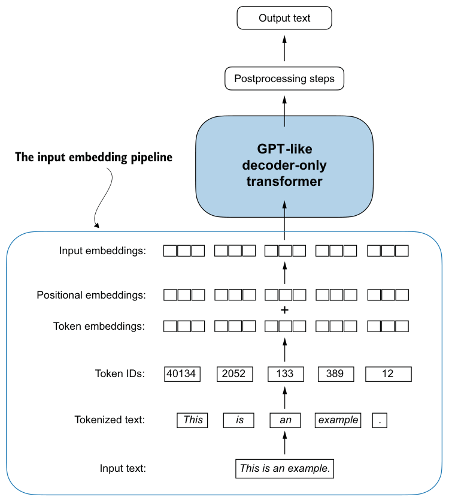
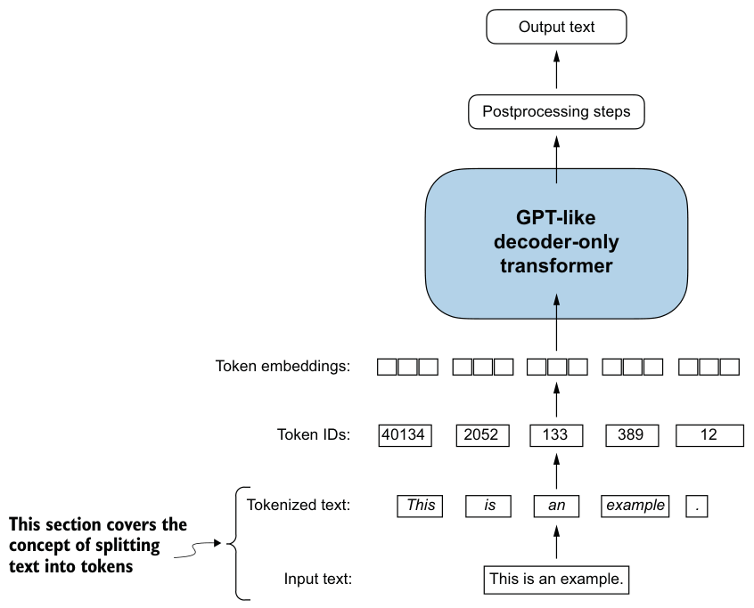
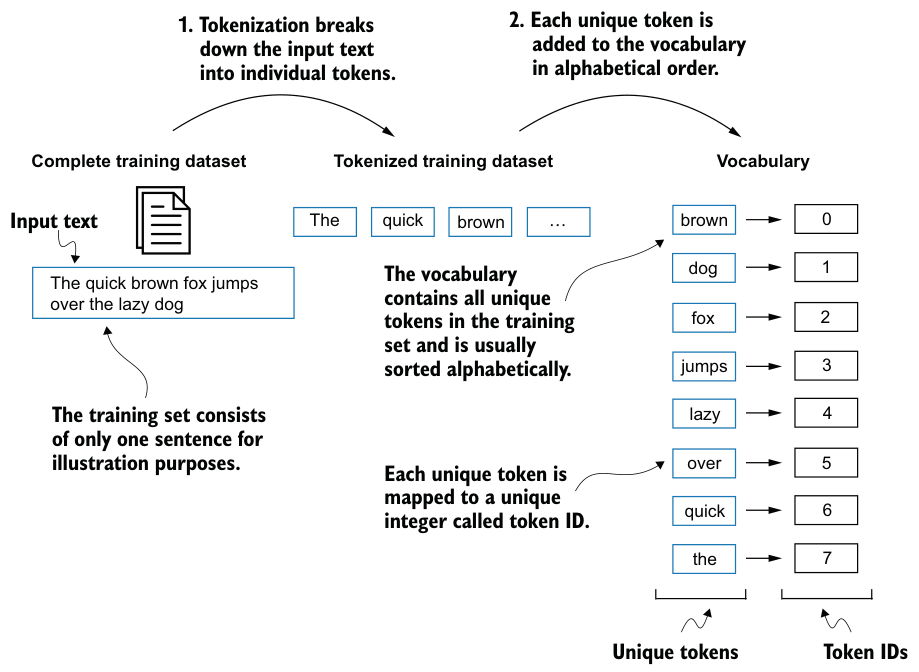
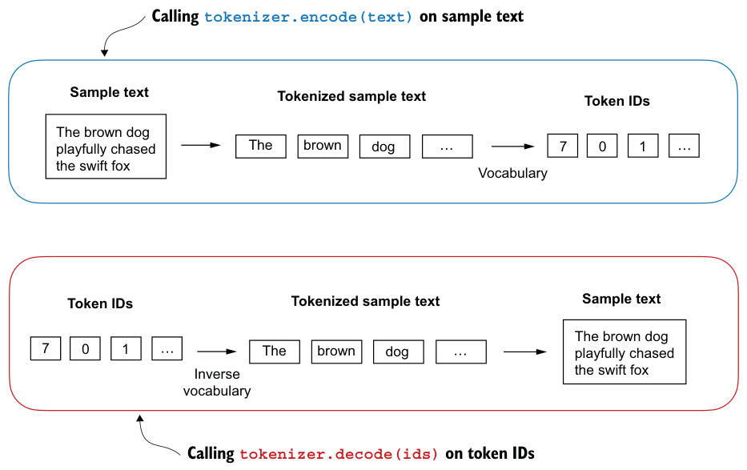
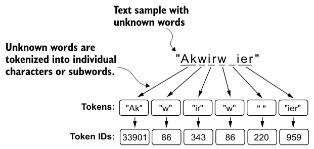
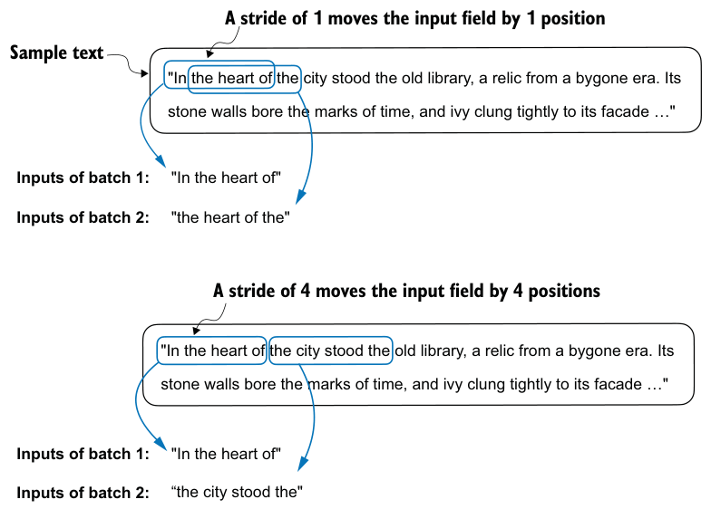
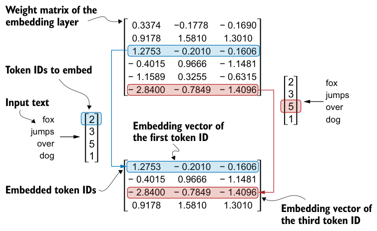
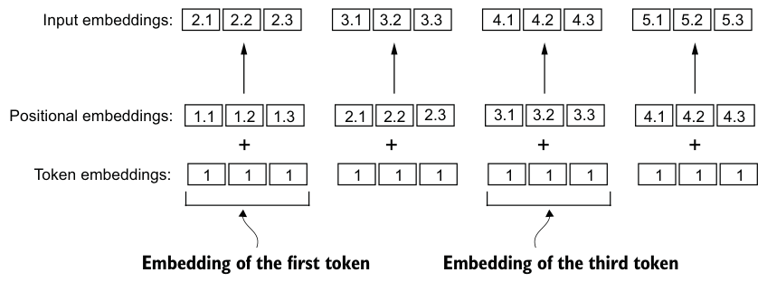

# Chapter 2: Working with Text Data

## Why this chapter matters

Neural networks only understand numbers — not text. Before any training can happen, raw text must go through a **preparation pipeline** that converts it into numerical vectors the model can process.

This chapter builds that pipeline from scratch, step by step.

---

## The Full Pipeline

```
raw text
   ↓  [2.2] Tokenization
tokens (strings)
   ↓  [2.3] Vocabulary lookup
token IDs (integers)
   ↓  [2.7] Embedding layer
token embeddings (float vectors)
   ↓  [2.8] + positional embeddings
input embeddings  ──→  LLM
```



---

## 2.2 Tokenization

**Why:** We need to break text into discrete units before we can map them to numbers.

Split text into **tokens** — individual words and punctuation characters treated as separate units.

```
"Hello, world." → ["Hello", ",", "world", "."]
```

Rules:
- Punctuation = separate tokens (they carry meaning on their own).
- Preserve capitalization (helps distinguish proper nouns, sentence structure).
- Strip whitespace tokens.



---

## 2.3 Vocabulary + Token IDs

**Why:** Tokens are still strings. We need integers to do any math.

Build a **vocabulary**: collect all unique tokens from the dataset, sort alphabetically, assign a unique integer to each.

```
vocab = { "!" → 0, "," → 1, "Hello" → 2, "world" → 3, ... }
```



Two operations on the tokenizer:

- `encode(text)` → list of token IDs
- `decode(ids)` → text



**Problem:** What if a word isn't in the vocabulary? → crash. This is why we need special tokens and BPE.

---

## 2.4 Special Tokens

**Why:** To handle edge cases that plain vocabulary can't cover.

| Token | Purpose |
|-------|---------|
| `<\|unk\|>` | Represents any word not in the vocabulary |
| `<\|endoftext\|>` | Separates unrelated documents concatenated together during training |

> GPT doesn't actually use `<|unk|>` — it solves the unknown-word problem with BPE instead.

---

## 2.5 Byte Pair Encoding (BPE)

**Why:** Word-level tokenizers fail on unknown words. BPE ensures **no word is ever truly unknown** — any string can be decomposed into known subword units.

Key idea: instead of treating words as atomic, break them into **subword pieces**.

```
"someunknownPlace" → ["some", "unknown", "Place"]
```

In the worst case, fall back to individual characters — which always exist in the vocabulary.



**How the vocabulary is built (bottom-up):**
1. Start with every individual character as a token.
2. Count which adjacent pair of tokens appears most frequently.
3. Merge that pair into a new single token.
4. Repeat until vocab reaches target size.

GPT-2 / GPT-3 / ChatGPT all use BPE with a vocabulary of **50,257 tokens**.

**Advantage over word-level tokenization:**

| | Word-level | BPE |
|---|---|---|
| Unknown word | crash / `<unk>` | split into subwords |
| `run` vs `running` | unrelated tokens | share the subword `run` |
| Vocab size | unbounded | fixed and compact |

---

## 2.6 Sliding Window — Input/Target Pairs

**Why:** LLM training requires `(input, target)` pairs. Given a long token sequence, we need a systematic way to generate thousands of training examples from it.

The training task is **next-word prediction**: given a sequence of tokens, predict the next one.

For a window of size 4:
```
tokens:  [A, B, C, D, E]
input:   [A, B, C, D]
target:  [B, C, D, E]   ← shifted by 1
```

Each window produces 4 training examples simultaneously:
```
[A]          → predict B
[A, B]       → predict C
[A, B, C]    → predict D
[A, B, C, D] → predict E
```

Then **slide** the window across the entire token sequence:



- **stride = 1** → maximum overlap, more training examples, higher risk of overfitting
- **stride = context_length** → no overlap, each token used exactly once per epoch

---

## 2.7 Token Embeddings

**Why:** Token IDs are arbitrary integers — `ID 3` is not "closer" to `ID 4` than to `ID 1000`. Neural networks need inputs that have **continuous, meaningful relationships**.

An **embedding layer** is a lookup table:

```
vocab_size × embed_dim   (e.g. 50257 × 768 for GPT-2 small)
```

Each row = a learned float vector for one token. Looking up token ID `k` = retrieving row `k`.



The table is **randomly initialized** and updated during training. By the end of training, tokens with similar meaning end up with similar vectors.

---

## 2.8 Positional Embeddings

**Why:** The embedding layer maps each token to the same vector regardless of where it appears in the sequence. But position matters:

```
"Dog bites man"  ≠  "Man bites dog"
```

Self-attention (ch.3) is also position-agnostic by design. Without positional information, the model cannot distinguish word order at all.

**Fix:** Add a second learnable lookup table — one vector per position:

```
context_length × embed_dim   (e.g. 1024 × 768)
```

Then simply add to the token embedding:

```
input_embedding[i] = token_embedding[i] + pos_embedding[i]
```



GPT uses **absolute positional embeddings** — one learned vector per absolute position. (The original Transformer used fixed sinusoidal functions instead.)

---

## Summary

| Step | Input | Output | Why |
|------|-------|--------|-----|
| Tokenize | raw text | string tokens | discrete units for lookup |
| Vocab map | string tokens | integer IDs | computers work with numbers |
| BPE | any string | subword token IDs | handle unknown words gracefully |
| Sliding window | token sequence | (input, target) pairs | generate training examples |
| Embedding | token IDs | float vectors | continuous representation for math |
| Positional emb. | positions | float vectors | inject word order information |
| **Sum** | token + pos emb | **input embeddings** | ready for the LLM |
