# Chapter 3: Coding Attention Mechanisms

## Why this chapter matters

In Chapter 2, raw text was converted into **input embeddings** (token embeddings + positional embeddings). However, those embeddings are **static and context-independent**: the word `"bank"` in *"river bank"* and *"bank account"* begins with the exact same token embedding vector.

The **attention mechanism** solves this by enabling each token to attend to every other token in the sequence. It computes **context vectors** that enrich each token's representation with contextual information from the entire input.

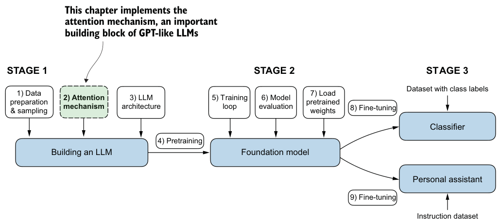

---

## The Four Attention Variants

This chapter builds attention mechanisms incrementally across four stages, culminating in the efficient Multi-Head Attention used in GPT models:

```
1. Simple Self-Attention         [3.3] No trainable weights (intuition & math)
           ↓
2. Trainable Self-Attention      [3.4] Learnable Q, K, V projection matrices
           ↓
3. Causal Attention              [3.5] Upper-triangular mask (prevent peeking into future)
           ↓
4. Multi-Head Attention (MHA)    [3.6] Multiple parallel heads + Weight Split
```

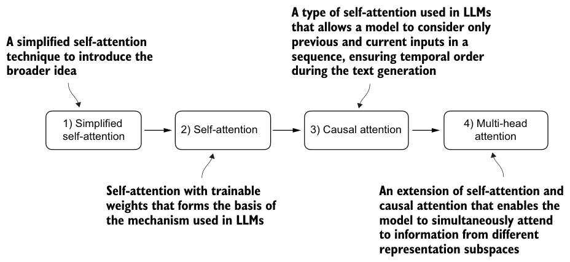

---

## 3.1 & 3.2 Sequence Modeling & The Attention Motivation

**Why:** Traditional RNN encoder-decoder architectures compress an entire sequence into a single fixed-size hidden state `h`. For long sequences, this creates an information bottleneck — early context is lost.

**Attention mechanism:** Allows the decoder to selectively access all hidden states from the input sequence at every step.

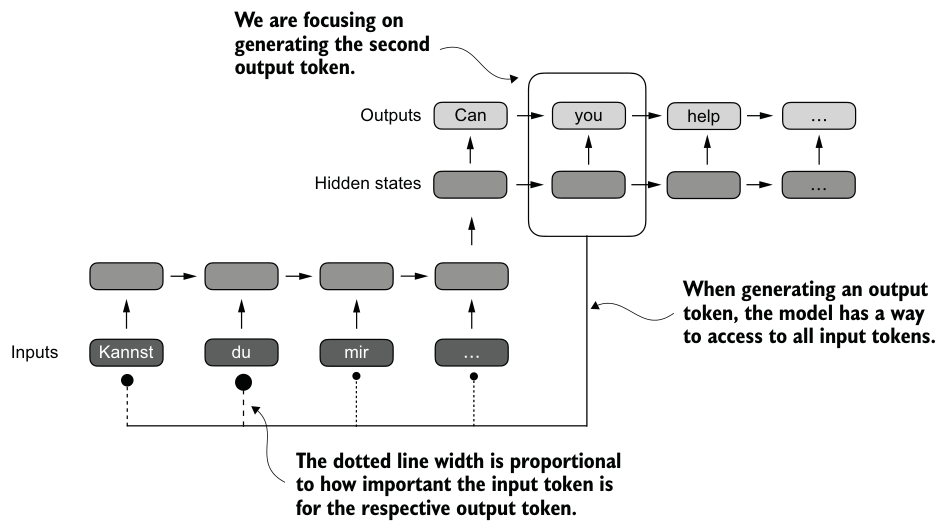

**Self-Attention:** Instead of connecting an encoder to a decoder, self-attention relates different positions within the **same** sequence to build a richer contextual representation.

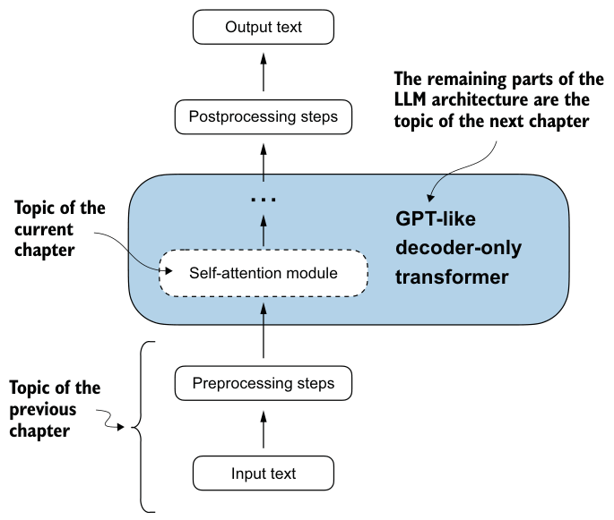

---

## 3.3 Simple Self-Attention (No Trainable Weights)

**Why:** Understand the core mechanics (dot product, softmax, weighted sum) before introducing trainable parameters.

For an input sequence `X = [x(1), x(2), ..., x(T)]` with shape `[T × d_in]`:

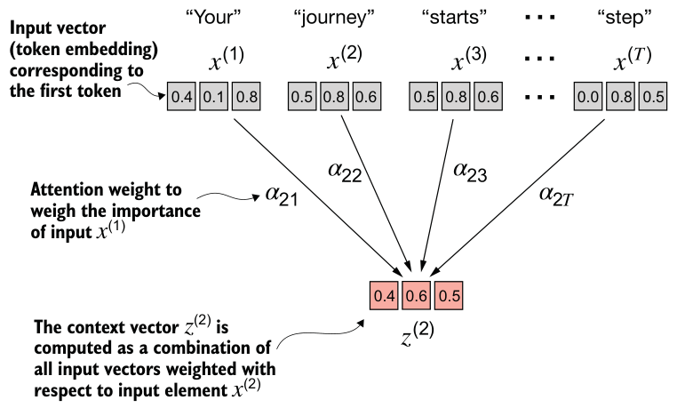

### Step 1: Attention Scores (ω)
Measure pairwise similarity via dot product:

```
ω_ij = x(i) · x(j)
```

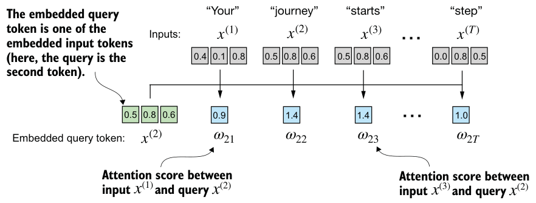

### Step 2: Attention Weights (α)
Normalize scores with Softmax so each row sums to 1.0:

```
α_ij = exp(ω_ij) / Σ_k exp(ω_ik)
```

### Step 3: Context Vectors (z)
Compute the weighted sum of input vectors:

```
z(i) = Σ_j α_ij * x(j)
```

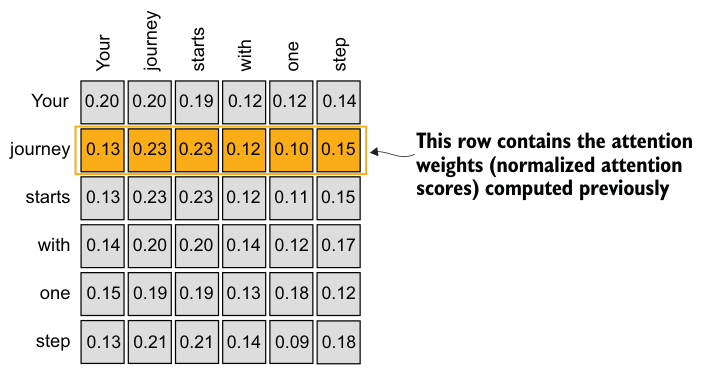

> **Limitation:** There are no learnable parameters. The model cannot learn distinct query vs. key semantics or adapt to different downstream tasks.

---

---

## 3.4 Single-Head Self-Attention with Trainable Weights

**Why:** Decouple each token into three specialized roles through learned linear projections. In single-head attention, there is **only one set** of projection weights (`W_Q, W_K, W_V`), producing a single attention map `[T × T]`.

| Role | Symbol | Description | Search Engine Analogy |
|------|--------|-------------|-----------------------|
| **Query** | `Q` | What the current token is looking for | The search query you type |
| **Key** | `K` | What features the token has to offer | Video titles / indexing tags |
| **Value** | `V` | The actual information content to retrieve | The video content itself |

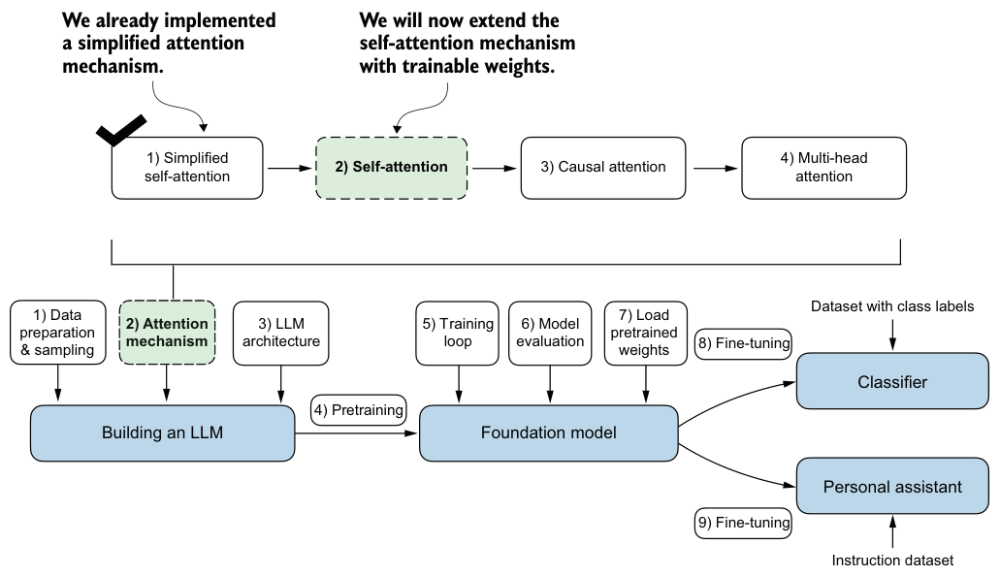

### Mathematical Formulation (Single-Head)

1. **Linear Projections:**
   ```
   Q = X @ W_Q    shape: [T × d_k]
   K = X @ W_K    shape: [T × d_k]
   V = X @ W_V    shape: [T × d_v]
   ```
   Where `X` has shape `[T × d_in]`, `W_Q` and `W_K` have shape `[d_in × d_k]`, and `W_V` has shape `[d_in × d_v]`.

2. **Attention Scores:**
   ```
   Scores = Q @ K.T    shape: [T × T]
   ```

   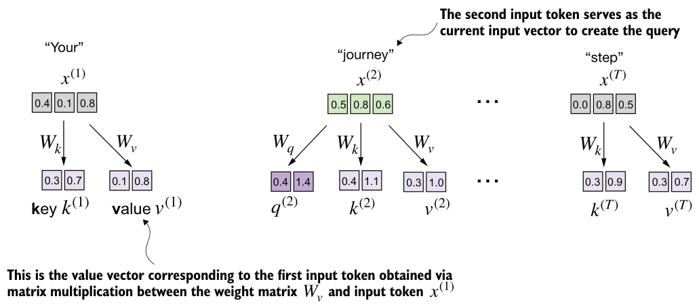

3. **Scaled Dot-Product & Softmax:**
   ```
   A = softmax( (Q @ K.T) / sqrt(d_k), dim=-1 )
   ```

   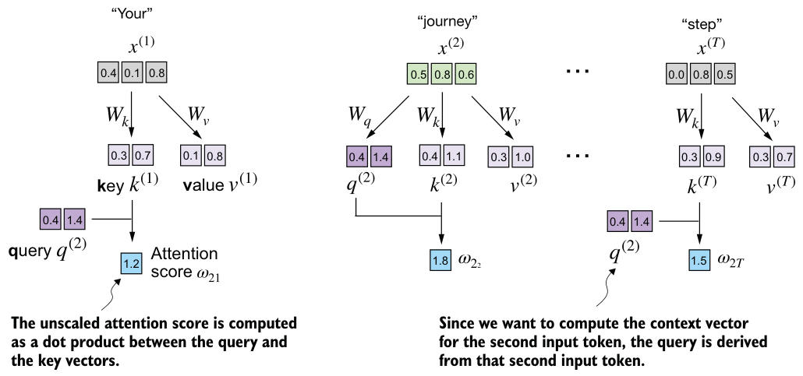

   > **Why divide by `sqrt(d_k)`?**
   > As dimension `d_k` grows, the dot products grow large in magnitude, pushing the softmax function into regions with tiny gradients (gradient vanishing). Dividing by `sqrt(d_k)` keeps the variance at 1.

4. **Context Vectors:**
   ```
   Z = A @ V    shape: [T × d_v]
   ```

   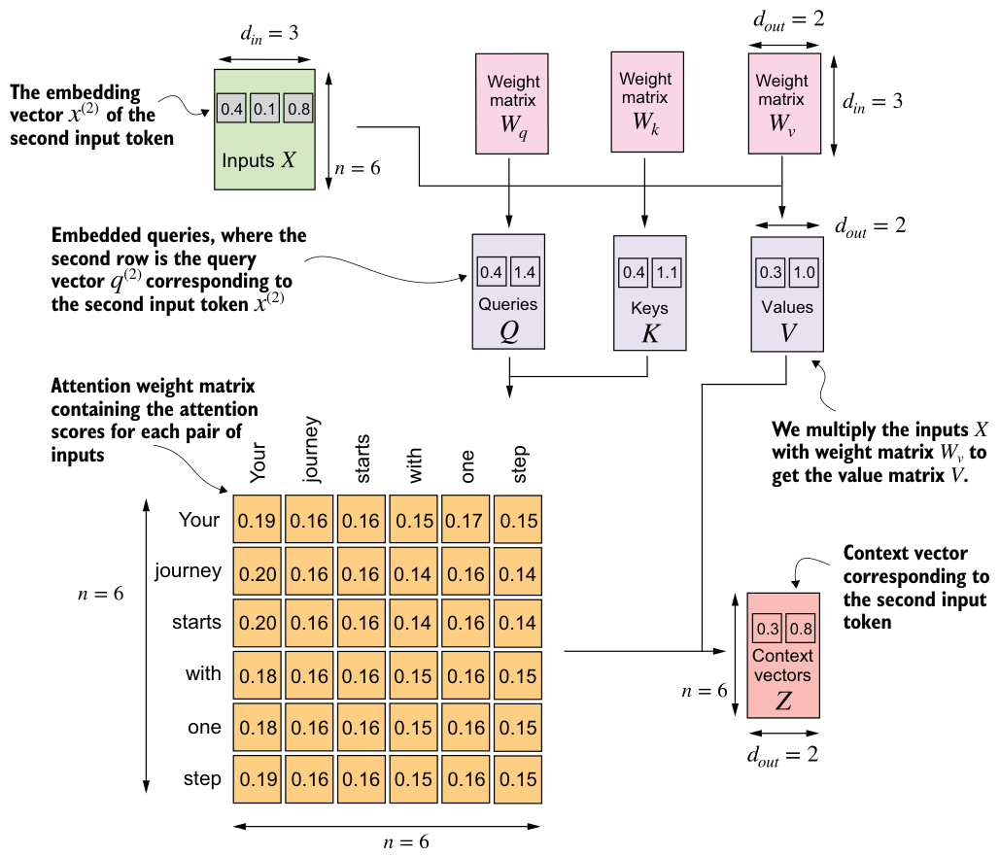

### Single-Head Implementations: SelfAttention_v1 vs. SelfAttention_v2
- **`SelfAttention_v1` (Section 3.4.1):** Uses raw weights `W_Q, W_K, W_V` of shape `[d_in × d_out]` with manual matrix multiplications `X @ W`.
- **`SelfAttention_v2` (Section 3.4.2):** Implemented using standard PyTorch `nn.Linear(d_in, d_out, bias=False)` layers. In C, this corresponds to `linear_forward` with weights in `[d_out × d_in]` layout.

---

## 3.5 Single-Head Causal Attention (CausalAttention)

**Why:** Autoregressive language models (like GPT) generate text **token by token from left to right**. When predicting the next token at position `t`, the model must not peek at future tokens `t+1, t+2, ...`.

`CausalAttention` is a single-head attention module that incorporates:
1. An upper-triangular **causal mask**
2. An optional **dropout layer** on attention weights

### 3.5.1 Causal Masking
Before applying softmax, mask the upper-triangular entries (`j > i`) with `-inf`:

```
Mask[i, j] = 0     if j <= i (past & present)
Mask[i, j] = -inf  if j >  i (future)

Scores_masked = (Q @ K.T) / sqrt(d_k) + Mask
```

Because `exp(-inf) = 0`, subsequent softmax normalizes future positions to exactly `0.0`:

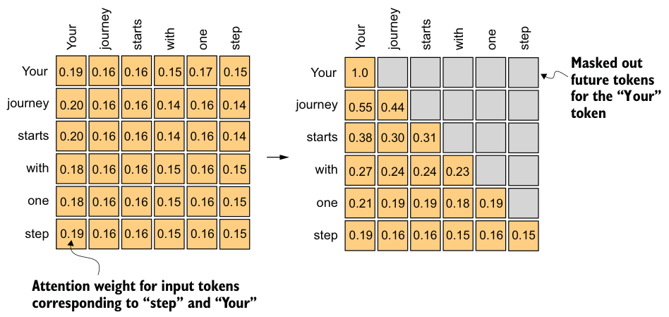

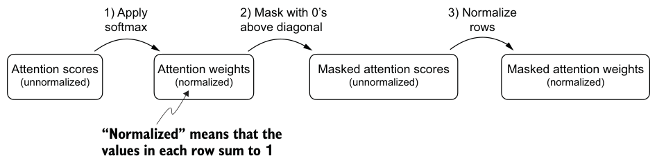

### 3.5.2 Dropout on Attention Weights
To prevent overfitting during training, randomly set some attention weights to 0 with probability `dropout_rate` and rescale remaining weights by `1 / (1 - dropout_rate)`:

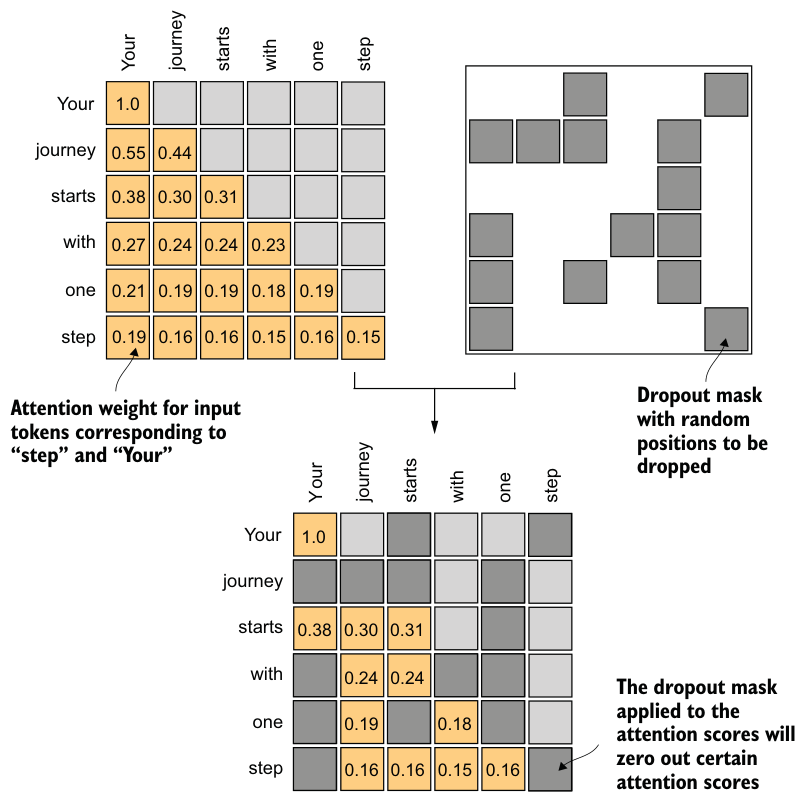

#### Training vs. Evaluation Mode
Dropout is only active during **training**. During inference (generating text) or evaluation (computing validation loss), dropout is disabled to ensure deterministic outputs:
- **PyTorch:** Toggled via `model.train()` vs. `model.eval()`.
- **C Implementation in this repo:**
  - **Training mode:** Pass a valid PRNG pointer (`Rng *rng`) to draw Bernoulli dropout masks.
  - **Evaluation mode:** Pass `rng = NULL` — `attention_forward` skips dropout entirely regardless of the configured rate.

### 3.5.3 The Single-Head Causal Class in C
In this repository, `SelfAttention_v2` and `CausalAttention` are both the `SelfAttention` struct in [`include/attention.h`](../include/attention.h): left with `causal = false` and `dropout = 0` it is `SelfAttention_v2`; with `causal` set it is `CausalAttention`.

```c
void attention_forward(float *out, float *weights, const float *q, const float *k, const float *v,
                       size_t T, size_t d, size_t ld, bool causal, double dropout, Rng *rng);

typedef struct {
    size_t d_in, d_out;
    float *w_query, *w_key, *w_value; /* [d_out x d_in] each */
    float *b_query, *b_key, *b_value; /* [d_out] each, or NULL for qkv_bias=False */
    bool causal;
    double dropout; /* rate on the attention weights */
} SelfAttention;

void self_attention_init(const SelfAttention *sa, Rng *rng);
size_t self_attention_scratch_size(const SelfAttention *sa, size_t T);
void self_attention_forward(float *out, const float *x, size_t B, size_t T,
                            const SelfAttention *sa, float *scratch, Rng *rng);
```

> **The Bottleneck of Single-Head Attention:**
> In single-head attention, all information is compressed through a single set of attention weights. If position i strongly attends to position j for a syntactic reason (e.g. subject-verb agreement), it cannot simultaneously attend to position k for a semantic reason (e.g. pronoun resolution) without diluting its attention. This directly motivates **Multi-Head Attention** in Section 3.6.

---

## 3.6 Multi-Head Attention (MHA) — Deep Dive

Multi-Head Attention is the central building block of modern Transformers. Instead of computing a single attention distribution, it splits the embedding into multiple subspaces called **heads**, running self-attention across all heads in parallel.

### 1. Motivation: Why Multiple Heads?
Human language expresses multiple simultaneous relationships between words:
- **Grammar/Syntax:** *"She"* → verb agreement with *"reads"*.
- **Semantics/Coreference:** *"The animal"* ↔ *"it"*.
- **Positional/Local Context:** Neighboring words and immediate qualifiers.

A single attention head cannot focus on all these disparate relationships at once. Multiple heads allow the model to learn diverse representation subspaces simultaneously.

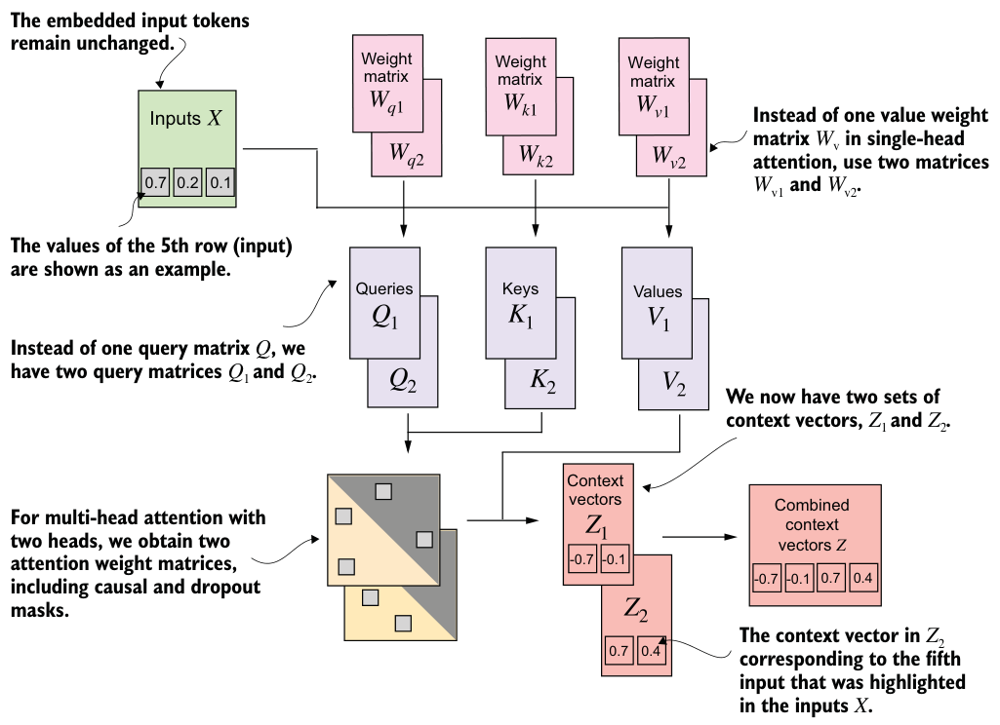

---

### 2. Naive Stacking vs. Weight Split

#### Naive Wrapper (`MultiHeadAttentionWrapper`)
Instantiates `h` independent `CausalAttention` modules:
- Sequentially computes `Q_i = X @ W_Q_i`, `K_i = X @ W_K_i`, `V_i = X @ W_V_i` for each head `i = 1 ... h`.
- Concatenates outputs along the embedding axis:
  ```
  Z_concat = [Z_1, Z_2, ..., Z_h]    shape: [T × (h * d_v)]
  ```

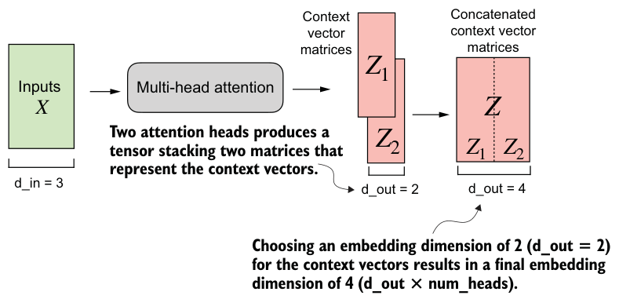

#### Efficient Weight Split (`MultiHeadAttention`)
Instead of `h` separate small matrix multiplications, use **one single large projection**:
- Initialize single matrices `W_Q, W_K, W_V` of shape `[C × C]`, where `C = d_model = h * d_head`.
- Perform one unified projection: `Q = X @ W_Q`, `K = X @ W_K`, `V = X @ W_V`.
- Reshape and slice the resulting tensors across heads.

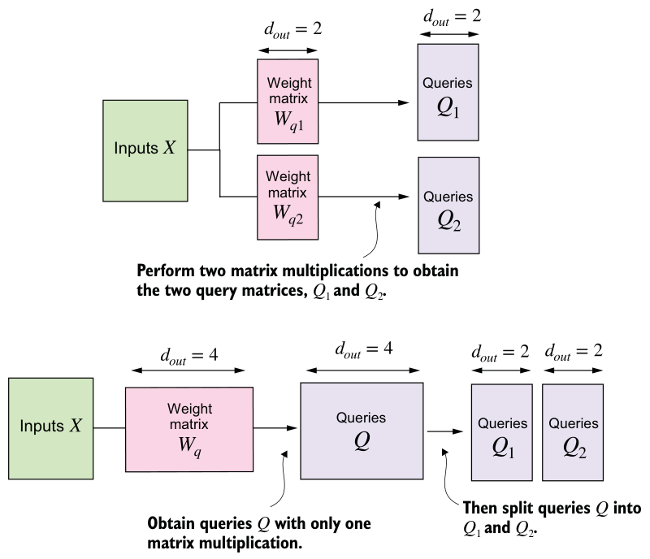

> **Computational Advantage:** Launching 1 large GEMM (General Matrix Multiply) utilizes GPU/CPU hardware and BLAS libraries far more efficiently than launching `h` tiny matrix multiplications.

---

### 3. Step-by-Step Tensor Dimensional Transformations

Tracing the tensor shapes through the pipeline is essential for bug-free implementation:

```
Input X: [B, T, C]
    │
    ├─────────────────────────────┬─────────────────────────────┐
    ▼                             ▼                             ▼
Q = X @ W_Q                   K = X @ W_K                   V = X @ W_V
[B, T, C]                     [B, T, C]                     [B, T, C]
    │                             │                             │
    └─────────────────────────────┼─────────────────────────────┘
                                  ▼
                1. Reshape: [B, T, h, d_head]
                                  │
                                  ▼
                2. Transpose (1 ↔ 2): [B, h, T, d_head]
                                  │
                                  ▼
                3. Batched Q @ K.T / sqrt(d_head): [B, h, T, T]
                                  │
                                  ▼
                4. Causal Mask & Softmax & Dropout: [B, h, T, T]
                                  │
                                  ▼
                5. Context = Attn @ V: [B, h, T, d_head]
                                  │
                                  ▼
                6. Transpose back (1 ↔ 2): [B, T, h, d_head]
                                  │
                                  ▼
                7. View / Flatten heads: [B, T, C]
                                  │
                                  ▼
                8. Output Projection @ W_O: [B, T, C]
```

#### Why transpose `[B, T, h, d_head]` → `[B, h, T, d_head]`?
Moving the head dimension `h` before sequence length `T` treats `[B, h]` as batch dimensions. Any matrix multiplication applied to the last two dimensions automatically operates independently and in parallel on each head's `[T × d_head]` matrix.

#### Why the Output Projection (`W_O`)?
Concatenating head outputs simply places vectors side-by-side. The learned weight matrix `W_O` of shape `[C × C]` linearly combines and blends the representations extracted from all distinct heads into a cohesive vector.

---

### 4. Implementation Perspective in Pure C

In C, multidimensional tensors are contiguous 1D flat arrays in **Row-Major** layout. This repo keeps the projections in the layout `nn.Linear` produces, `[B, T, C]` = `[B, T, h, d_head]`, and never performs the transposes (steps 2 and 6) or the view (step 7) of the pipeline above. Element `Q[b][t][head][d]` sits at offset `b * T * C + t * C + head * d_head + d`.

[`include/attention.h`](../include/attention.h):

```c
typedef struct {
    size_t d_in, d_out, num_heads;    /* num_heads must divide d_out */
    float *w_query, *w_key, *w_value; /* [d_out x d_in] each */
    float *b_query, *b_key, *b_value; /* [d_out] each, or NULL for qkv_bias=False */
    float *w_out, *b_out;             /* out_proj: [d_out x d_out] and [d_out] */
    double dropout;                   /* rate on the attention weights */
} MultiHeadAttention;

void multi_head_attention_init(const MultiHeadAttention *mha, Rng *rng);
size_t multi_head_attention_scratch_size(const MultiHeadAttention *mha, size_t T);
void multi_head_attention_forward(float *out, const float *x, size_t B, size_t T,
                                  const MultiHeadAttention *mha, float *scratch, Rng *rng);
```

**Splitting Heads without Copying:**
Head `head` owns columns `[head * d_head, (head + 1) * d_head)` of every row. `attention_forward` takes a row stride `ld`, so `multi_head_attention_forward` hands each head a pointer to its first column of `q`, `k`, `v` and `context`, with `d = d_head` and `ld = C`. Each head writes its context vectors into the same columns of `context`, so after the loop over heads they already sit side by side as `[T, C]`, ready for the output projection `W_O`.

**No Physical Transpose of K:**
Instead of building `K.T` in a temporary buffer, `attention_forward` takes the dot product of row `i` of `Q` with row `j` of `K` directly, both rows `ld` floats apart. Within a row both vectors are read with unit stride, which keeps the inner loop cache-friendly and easy to auto-vectorize (SIMD). With the causal mask, it computes scores only for `j <= i` and sets the rest to `-inf` directly.

---

## 3.7 Summary of GPT-2 Attention Specifications

| Parameter | GPT-2 Small | GPT-2 Medium | GPT-2 Large | GPT-2 XL |
|-----------|-------------|--------------|-------------|----------|
| Embedding Dimension (`C`) | 768 | 1024 | 1280 | 1600 |
| Attention Heads (`h`) | 12 | 16 | 20 | 25 |
| Head Dimension (`d_head`) | 64 | 64 | 64 | 64 |
| Context Length (`T`) | 1024 | 1024 | 1024 | 1024 |
| Total MHA Parameters per Layer | ~2.36M | ~4.19M | ~6.55M | ~10.24M |

---

## Chapter 3 Summary Table

| Concept | Key Equations / Operations | Learnable Parameters | Why |
|---------|----------------------------|----------------------|-----|
| **Dot-product Attention** | `ω = x(i) · x(j)`, `α = softmax(ω)` | None | Foundation for measuring token relevance |
| **Trainable Projections** | `Q = X @ W_Q`, `K = X @ W_K`, `V = X @ W_V` | `W_Q, W_K, W_V` | Separates role of querying, key matching, and content retrieval |
| **Scaled Factor** | `1 / sqrt(d_k)` | None | Stabilizes softmax gradients when dimension is large |
| **Causal Mask** | Mask upper-triangle with `-inf` | None | Ensures autoregressive generation (cannot look ahead) |
| **Attention Dropout** | Zero-out attention weights with rate `p` | None | Regularization against overfitting |
| **Multi-Head Attention** | Split into `h` heads, batched attn, concat, `W_O` | `W_Q, W_K, W_V, W_O` | Simultaneously captures multiple linguistic relationships |
