# Chapter 4: Implementing a GPT Model

## Why this chapter matters

In Chapter 2, raw text was tokenized and embedded into vectors (token + positional embeddings). In Chapter 3, the multi-head attention mechanism was developed to compute dynamic, context-rich representations.

Now, Chapter 4 connects all these building blocks together to create a fully functioning **GPT-2 (124M parameters)** model from scratch, capable of autoregressive text generation.

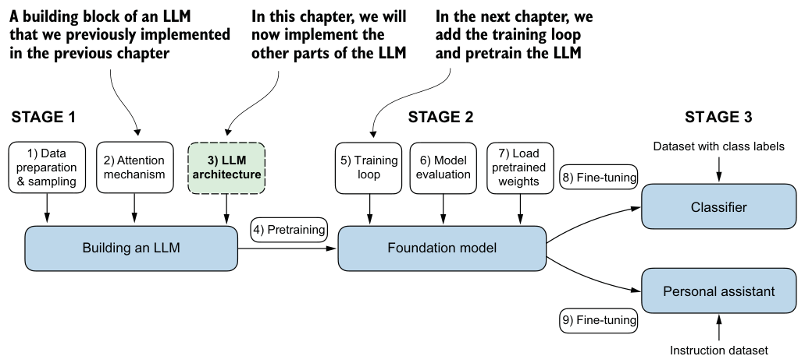

---

## The GPT Architecture Pipeline

A decoder-only autoregressive LLM consists of three core stages:
1. **Embedding Layer**: Converts input token IDs into vectors and adds positional embeddings + dropout.
2. **Transformer Blocks ($\times N$)**: Repeated blocks containing Pre-LayerNorm, Multi-Head Attention, Feed-Forward Network (GELU), and Residual / Shortcut connections.
3. **Output Head**: Final LayerNorm followed by a Linear projection mapping hidden features back to the vocabulary size (`vocab_size`) to produce logits.

```
Token IDs [B x T]
    ↓  Token & Positional Embeddings
Embeddings [B x T x emb_dim]
    ↓  Embedding Dropout (training only)
    ↓  Transformer Block 1  [B x T x emb_dim]
    ↓  Transformer Block 2  [B x T x emb_dim]
    ...
    ↓  Transformer Block 12 [B x T x emb_dim]
    ↓  Final LayerNorm
    ↓  Linear Output Head (projection to vocab_size)
Logits [B x T x vocab_size]
    ↓  Softmax & Next-token selection (Greedy / Sampling)
Next Token ID
```

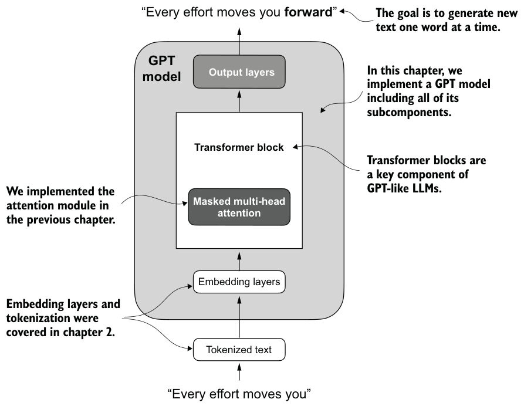

---

## 4.1 Coding an LLM Architecture

**Why:** Before implementing the individual sub-modules, we establish the top-down blueprint, configuration hyper-parameters, and tensor shape contracts across the entire model.

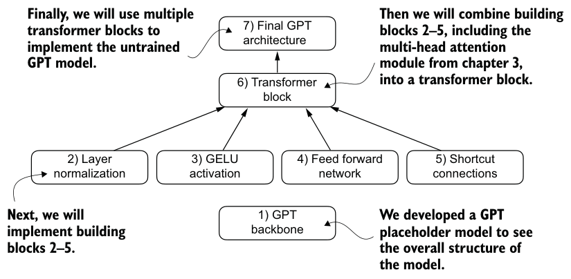

### Model Configuration (`GPTConfig`)

For the standard GPT-2 Small (124M parameters), `GPT_CONFIG_124M`:

| Field | GPT-2 Small | Meaning |
|---|---|---|
| `vocab_size` | 50257 | Size of the BPE tokenizer vocabulary |
| `context_length` | 1024 | Maximum sequence length supported ($T_{\max}$) |
| `emb_dim` | 768 | Hidden embedding dimension ($d_{\text{model}}$) |
| `n_heads` | 12 | Attention heads (head_dim = 768 / 12 = 64) |
| `n_layers` | 12 | Stacked transformer blocks |
| `drop_rate` | 0.1 | Rate of every dropout layer |
| `qkv_bias` | false | Biases on the Q, K, V projections |

In C ([`include/gpt.h`](../include/gpt.h)):

```c
typedef struct {
    size_t vocab_size, context_length, emb_dim, n_heads, n_layers;
    double drop_rate;
    bool qkv_bias;
} GPTConfig;

extern const GPTConfig GPT_CONFIG_124M;
```

---

### Data Flow & Tensor Shape Progression

Given a batch of $B = 2$ sequences with context length $T = 4$:

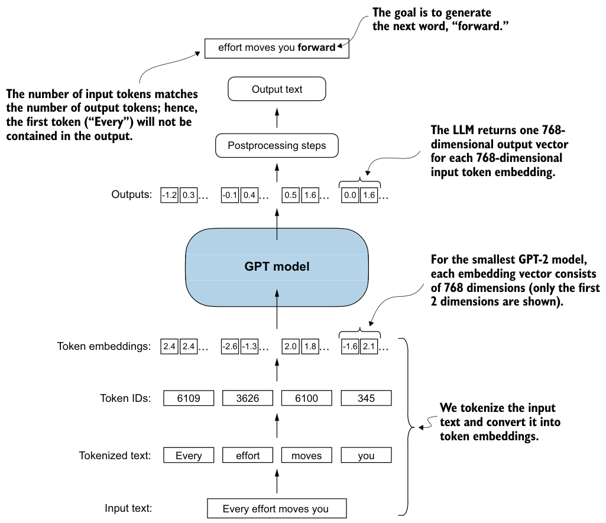

| Step | Operation | Input Shape | Output Shape | Notes |
|---|---|---|---|---|
| **1. Input** | Tokenizer output | — | `[B, T]` = `[2, 4]` | Integer token IDs |
| **2. Token Embedding** | `tok_emb(idx)` | `[B, T]` | `[B, T, 768]` | Table lookup |
| **3. Pos Embedding** | `pos_emb(0..T-1)` | `[T]` | `[T, 768]` | Positional vectors |
| **4. Combined Emb** | `tok_emb + pos_emb` | `[B, T, 768]`, `[T, 768]` | `[B, T, 768]` | Element-wise broadcast add |
| **5. Emb Dropout** | `drop_emb(x)` | `[B, T, 768]` | `[B, T, 768]` | Zeroes out features with prob $p$ |
| **6. Blocks (x12)** | `trf_blocks(x)` | `[B, T, 768]` | `[B, T, 768]` | **Preserves dimensions** |
| **7. Final LN** | `final_norm(x)` | `[B, T, 768]` | `[B, T, 768]` | Normalizes last dimension |
| **8. Output Head** | `out_head(x)` | `[B, T, 768]` | `[B, T, 50257]` | Linear projection to vocab |

---

### Why Embedding Dropout?

- **Regularization (Anti-overfitting):** Prevents the network from co-adapting and over-relying on specific token/position embedding combinations.
- **Training vs. Inference:**
  - **Training:** Active ($p = 0.1$), randomly drops elements and scales remaining by $\frac{1}{1-p}$ (inverted dropout).
  - **Evaluation / Generation (Inference):** **Disabled completely** ($p = 0$ or `rng = NULL`) to ensure deterministic and full-capacity output.

---

### The Placeholder / Blueprint Architecture (`DummyGPTModel`)

The book first sketches the model top-down with placeholder modules (`DummyTransformerBlock`, `DummyLayerNorm`) that pass their input through unchanged, to fix the input and output shapes before any building block exists. The C code skips this step: section 4.6 assembles the real modules directly.

---

## 4.2 Normalizing Activations with Layer Normalization

**Why:** Deep neural networks suffer from training instabilities caused by shifting activation distributions and ill-conditioned gradient flow across many stacked layers. Layer Normalization stabilizes activations, ensuring consistent convergence.

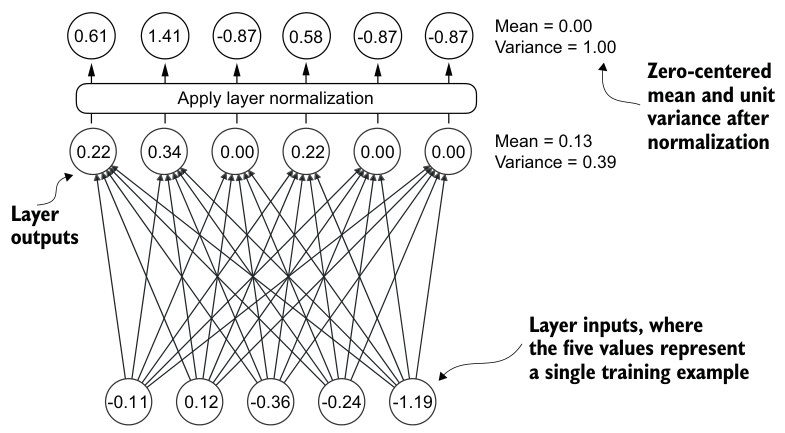

> 📖 **Deep Dive Concept:** For an in-depth mathematical exploration of gradients, backpropagation, and vanishing/exploding gradient pathologies, see [Gradients, Backpropagation, and Vanishing/Exploding Gradients](concepts/gradients-and-vanishing-exploding.md).

---

### Why Normalization Matters

In deep networks (like GPT-2 with 12 stacked transformer blocks), activations across layers easily drift in scale and mean (**Internal Covariate Shift**), leading to vanishing or exploding gradients.

**Layer Normalization (LayerNorm)** stabilizes the forward and backward passes by continually rescaling activations to have zero mean ($\mu = 0$) and unit variance ($\sigma^2 = 1$). This bounds intermediate signal magnitudes, smooths the optimization landscape, and allows for higher learning rates with reliable convergence.

---

### Layer Normalization vs. Batch Normalization

```
         Batch Normalization (BatchNorm)                 Layer Normalization (LayerNorm)
       Normalizes across BATCH dimension               Normalizes across FEATURE dimension
            
         Token 1   Token 2   ...  Token d                Token 1   Token 2   ...  Token d
Sample 1 [   x         x            x   ]        Sample 1 [═══ x ═════ x ══════════ x ═══] → (μ₁, σ₁²)
Sample 2 [   x         x            x   ]        Sample 2 [═══ x ═════ x ══════════ x ═══] → (μ₂, σ₂²)
           │         │            │
           ▼         ▼            ▼
        (μ₁,σ₁²)  (μ₂,σ₂²)     (μ_d,σ_d²)
```

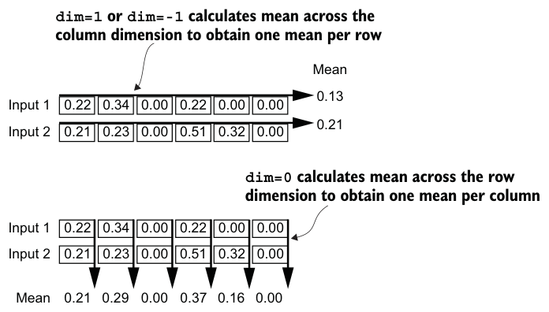

| Aspect | Batch Normalization | Layer Normalization |
|---|---|---|
| **Normalization Axis** | Across batch elements ($B$) for each feature | Across embedding features ($d_{\text{emb}}$) for each token |
| **Batch Dependency** | Dependent on batch statistics. Fails when $B=1$ or small | **100% batch-independent**. Identical behavior for $B=1$ and $B=128$ |
| **Suitability for LLMs**| ❌ Poor (autoregressive decoding uses $B=1$ with varying sequence lengths) | ✅ **Standard for Transformers** and sequence modeling |

---

### Mathematical Formulation (Step-by-Step)

For an input token representation vector $\mathbf{x} = [x_1, x_2, \dots, x_d] \in \mathbb{R}^d$ (where $d = 768$ in GPT-2 Small):

```
x (d-dim) ──► 1. Mean (μ) & Variance (σ²) ──► 2. Normalize to Mean=0, Var=1 ──► 3. Scale & Shift: y = γ ⊙ x̂ + β
```

#### Step 1: Compute Mean ($\mu$)
Calculate the average activation value across all $d$ features of the token vector:
$$\mu = \frac{1}{d} \sum_{i=1}^d x_i$$

#### Step 2: Compute Variance ($\sigma^2$)
Measure the spread and dispersion of feature values around the mean:
$$\sigma^2 = \frac{1}{d} \sum_{i=1}^d (x_i - \mu)^2$$

> [!NOTE]
> **Biased Variance ($d$ vs. $d-1$):** In statistics, sample variance uses Bessel's correction with denominator $d-1$. In deep learning frameworks (PyTorch `unbiased=False`, TensorFlow, GPT-2), the population variance with denominator $d$ is used. With $d = 768$, the numerical difference between $768$ and $767$ is negligible, but using $d$ guarantees exact bitwise compatibility with OpenAI's pretrained GPT-2 weights.

#### Step 3: Standardization (Normalize to Mean = 0, Variance = 1)
Center the activations at zero by subtracting the mean $\mu$, and rescale them to unit variance by dividing by the standard deviation $\sqrt{\sigma^2 + \epsilon}$:
$$\hat{x}_i = \frac{x_i - \mu}{\sqrt{\sigma^2 + \epsilon}}$$
* $\epsilon$ (epsilon, typically $10^{-5}$): a tiny numerical stabilizer added to the denominator to prevent division by zero when variance is near zero.
* **Result:** Normalized values $\hat{\mathbf{x}}$ have zero mean and unit variance ($\mu \approx 0, \sigma^2 \approx 1$), preventing activation values from drifting or exploding as they flow through deep layers.

#### Step 4: Scale ($\gamma$) and Shift ($\beta$) — Learnable Parameters
Scale by $\gamma$ and shift by $\beta$ to allow the network to adaptively restore any specific distribution required by subsequent layers:
$$y_i = \gamma_i \cdot \hat{x}_i + \beta_i$$

* **Initial Values:**
  - $\boldsymbol{\gamma}$ (scale): initialized to all **$1.0$** (dimension $d$).
  - $\boldsymbol{\beta}$ (shift): initialized to all **$0.0$** (dimension $d$).
* **Role:** While standardizing to $\mu=0, \sigma^2=1$ provides stability, the network can adaptively learn through backpropagation to scale or shift specific feature channels if doing so minimizes the loss (e.g., if $\gamma=1$ and $\beta=0$, $y_i = \hat{x}_i$ is identity).

---

### C API

[`include/layernorm.h`](../include/layernorm.h):

```c
#define LAYERNORM_EPS 1e-5f

typedef struct {
    size_t dim;
    float *scale; /* [dim] */
    float *shift; /* [dim] */
} LayerNorm;

void layernorm_init(const LayerNorm *ln);  /* scale = 1, shift = 0 */
void layernorm_forward(float *out, const float *x, size_t n, const LayerNorm *ln);
```

`layernorm_forward` normalizes `n` rows of `dim` values with the biased variance; `out` may be `x`.

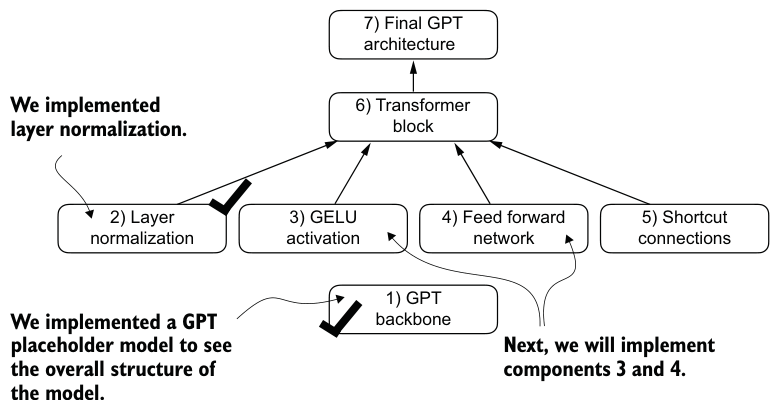

---

## 4.3 Implementing a Feed-Forward Network with GELU Activations

**Why:** Multi-Head Attention mixes information across different token positions in the sequence. In contrast, the Feed-Forward Network (FFN) operates **position-wise** (independently on each token), performing non-linear feature transformations and deepening the model's capacity.

```
Input Sequence: [Token 1, Token 2, Token 3]
                     │
        ┌────────────┴────────────┐
        │   Multi-Head Attention  │  ← Inter-token contextual communication
        └────────────┬────────────┘
                     │
        ┌────────────┴────────────┐
        │   Feed-Forward Network  │  ← Intra-token non-linear feature transformation
        └────────────┬────────────┘
                     │
Output Sequence: [Token 1, Token 2, Token 3]
```

---

### GELU vs. ReLU Activation

Standard neural networks traditionally used **ReLU** ($\text{ReLU}(x) = \max(0, x)$). However, modern LLMs (GPT-2, GPT-3, BERT) adopt **GELU (Gaussian Error Linear Unit)**.

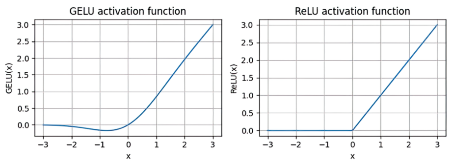

```
          ReLU Activation                               GELU Activation
     (Piecewise linear, sharp corner)              (Smooth curve, non-zero negative gradient)

        y ▲                                           y ▲
          │    /                                        │    /
          │   /                                         │   /
          │  /                                          │  /
──────────┼─/────────► x                     ───────────┼─/────────► x
          │/ (Hard corner at 0)                         │ \_ (Smooth dip at x ≈ -0.75)
```

| Property | ReLU | GELU |
|---|---|---|
| **Formula** | $\max(0, x)$ | $x \cdot \Phi(x)$ where $\Phi(x) = P(X \le x), X \sim \mathcal{N}(0,1)$ |
| **Negative Regime ($x < 0$)** | Exactly $0 \implies$ Gradient is $0$ | Smooth negative dip (min $\approx -0.17$ at $x \approx -0.75$) $\implies$ **Non-zero gradient** |
| **Dying Neurons** | ⚠️ High risk (neurons with negative inputs stop updating) | ✅ **Prevented** (negative inputs continue contributing gradient flow) |
| **Differentiability** | Non-differentiable at $x = 0$ | **Smooth & continuously differentiable** across the entire domain |

---

### GELU Mathematical Approximation

The exact CDF integral of the standard normal distribution is computationally expensive. In practice (and in GPT-2), a fast curve-fitted $\tanh$ approximation is used:

$$\text{GELU}(x) \approx 0.5 \cdot x \cdot \left( 1 + \tanh\left( \sqrt{\frac{2}{\pi}} \cdot \left( x + 0.044715 \cdot x^3 \right) \right) \right)$$

where $\sqrt{\frac{2}{\pi}} \approx 0.7978845608$.

---

### Feed-Forward Network Architecture

The `FeedForward` module consists of two linear transformations with an intermediate GELU activation:

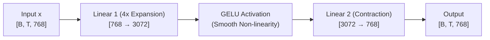

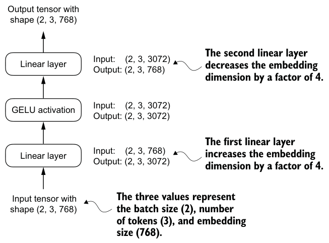
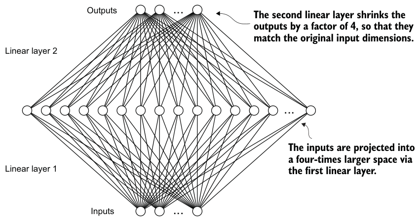

#### Why 4x Expansion and Contraction?
1. **Richer Representation Space:** Expanding from $768 \to 3072$ ($4 \times d_{\text{emb}}$) projects token representations into a higher-dimensional space where complex non-linear feature interactions can be separated and learned.
2. **Dimension Preservation:** Compressing back from $3072 \to 768$ ensures the output matches the input dimension `[B, T, 768]`, allowing identical blocks to be sequentially stacked without dimensional mismatch.

---

### C API

[`include/activation.h`](../include/activation.h):

```c
void gelu_forward(float *x, size_t n); /* in place, tanh approximation */
```

[`include/feedforward.h`](../include/feedforward.h):

```c
typedef struct {
    size_t emb_dim, hidden_dim;
    float *w_in, *b_in;   /* layers[0]: [hidden_dim x emb_dim], [hidden_dim] */
    float *w_out, *b_out; /* layers[2]: [emb_dim x hidden_dim], [emb_dim] */
} FeedForward;

void feed_forward_init(const FeedForward *ff, Rng *rng);
size_t feed_forward_scratch_size(const FeedForward *ff);
void feed_forward_forward(float *out, const float *x, size_t n, const FeedForward *ff,
                          float *scratch);
```

GPT-2 uses `hidden_dim = 4 * emb_dim`. Tokens go through one at a time, so the scratch is one hidden row whatever the number of tokens.

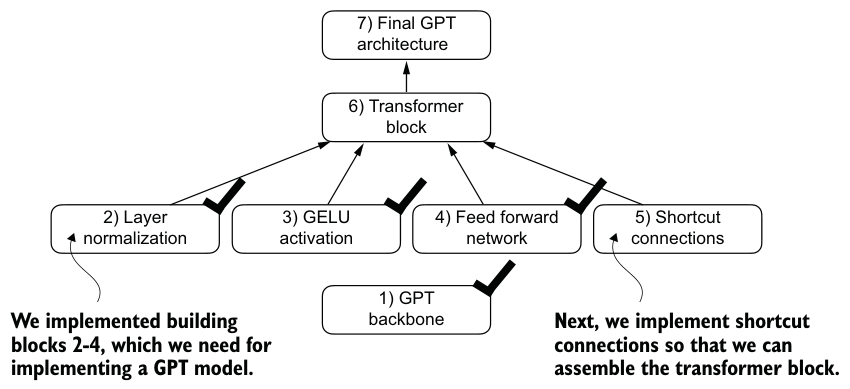

---

## 4.4 Adding Shortcut Connections

**Why:** In deep neural networks, gradients diminish exponentially as they backpropagate across many layers (the vanishing gradient problem). **Shortcut connections** (also known as skip or residual connections) create direct identity paths that bypass layers, preserving gradient magnitude throughout the network.

```
      Without Shortcut Connection                        With Shortcut (Residual) Connection
       
              x                                                  x
              │                                            ┌─────┴─────┐
              ▼                                            │           ▼
        ┌───────────┐                                      │     ┌───────────┐
        │  Layer(x) │                                      │     │  Layer(x) │
        └─────┬─────┘                                      │     └─────┬─────┘
              │                                            │           ▼
              ▼                                            └────────► ( + )  ← y = x + Layer(x)
              y                                                        │
                                                                       ▼
                                                                       y
```

---

### Mathematical Mechanism: The Identity Gradient Highway

In a standard forward pass with a shortcut connection:
$$\mathbf{y} = \mathbf{x} + F(\mathbf{x})$$

where $\mathbf{x}$ is the original identity input and $F(\mathbf{x})$ is the transformation computed by the layer.

#### Backward Pass Derivation:
Applying the chain rule to compute the gradient with respect to input $\mathbf{x}$:

$$\frac{\partial \mathcal{L}}{\partial \mathbf{x}} = \frac{\partial \mathcal{L}}{\partial \mathbf{y}} \cdot \frac{\partial \mathbf{y}}{\partial \mathbf{x}} = \frac{\partial \mathcal{L}}{\partial \mathbf{y}} \cdot \left( \mathbf{I} + \frac{\partial F}{\partial \mathbf{x}} \right) = \frac{\partial \mathcal{L}}{\partial \mathbf{y}} + \frac{\partial \mathcal{L}}{\partial \mathbf{y}} \cdot \frac{\partial F}{\partial \mathbf{x}}$$

> [!IMPORTANT]
> **The $\mathbf{I}$ (Identity Matrix) Term:**
> Because the derivative contains an explicit $\mathbf{I}$, even if the learned sub-layer's gradient $\frac{\partial F}{\partial \mathbf{x}}$ completely vanishes ($\approx 0$), the total gradient retains the term $\frac{\partial \mathcal{L}}{\partial \mathbf{y}}$. This acts as a **superhighway** allowing gradient signals to flow across arbitrarily deep stacks of transformer blocks directly back to early layers.

---

### Empirical Verification: Gradient Flow Comparison

In a 5-layer deep neural network experiment:

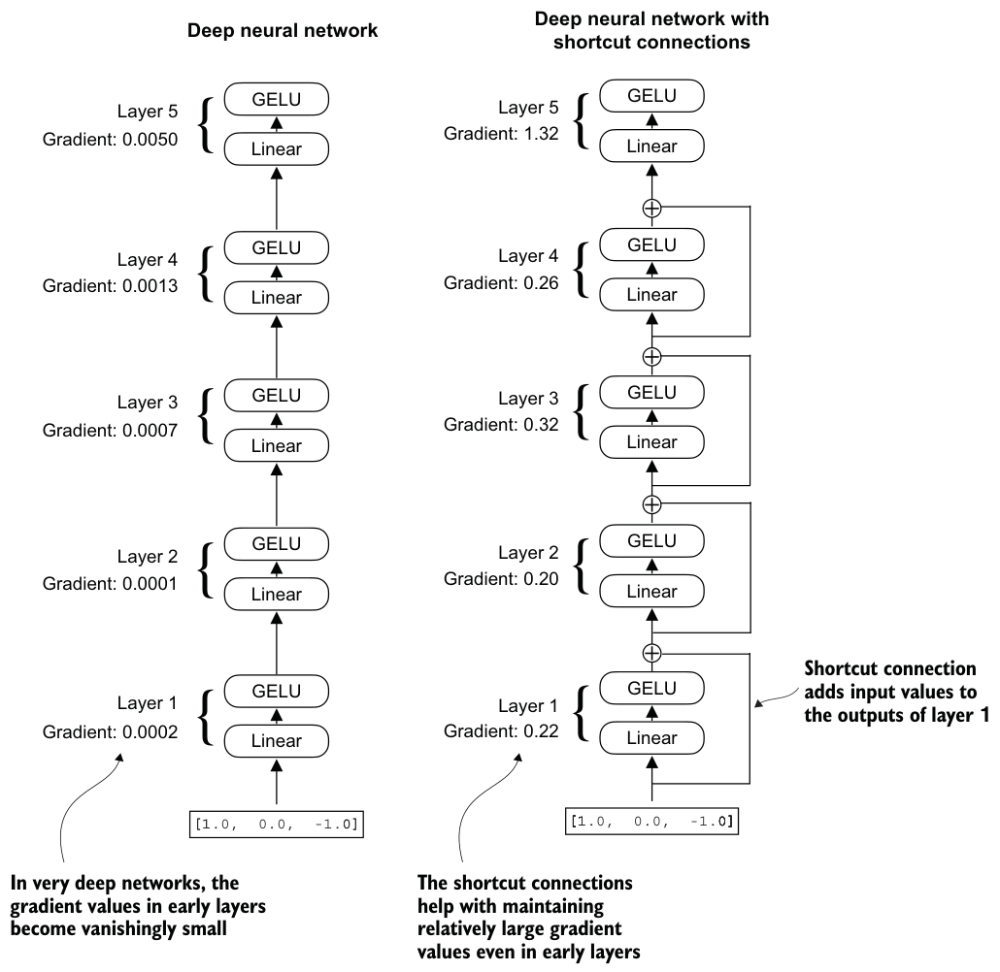

| Layer | Mean Gradient (Without Shortcut) | Mean Gradient (With Shortcut) |
|---|---|---|
| **Layer 4 (Output)** | `0.0050` | `1.3258` |
| **Layer 3** | `0.0014` | `0.2666` |
| **Layer 2** | `0.0007` | `0.3290` |
| **Layer 1** | `0.0001` | `0.2069` |
| **Layer 0 (Input)** | `0.0002` *(decayed by 96%)* | `0.2217` *(healthy & stable)* |

---

### Placement in Transformer Blocks

In each GPT-2 transformer block, shortcut connections are applied twice:
1. **Around Attention:** $\mathbf{x} \leftarrow \mathbf{x} + \text{Dropout}(\text{MHA}(\text{LN}_1(\mathbf{x})))$
2. **Around Feed-Forward:** $\mathbf{x} \leftarrow \mathbf{x} + \text{Dropout}(\text{FFN}(\text{LN}_2(\mathbf{x})))$

> **Shape Contract:** Shortcut addition requires $\text{shape}(F(\mathbf{x})) == \text{shape}(\mathbf{x}) = [B, T, d_{\text{emb}}]$.

---

### C API

[`include/ops.h`](../include/ops.h):

```c
void residual_add(float *x, const float *y, size_t n); /* x += y */
```

The gradient table above comes from the book. Reproducing it needs a backward pass, which arrives in Chapter 5; for now the tests check the forward pass of the 5-layer example network, with and without shortcuts.

---

## 4.5 Connecting Attention and Linear Layers in a Transformer Block

**Why:** The **Transformer Block** is the fundamental modular building block of GPT. In the 124M-parameter GPT-2 architecture, this block is stacked **12 times** sequentially.

It integrates all four sub-components into a unified, shape-preserving block:
1. **Multi-Head Attention** (Chapter 3)
2. **Layer Normalization** (Section 4.2)
3. **Feed-Forward Network with GELU** (Section 4.3)
4. **Shortcut / Residual Connections** (Section 4.4)

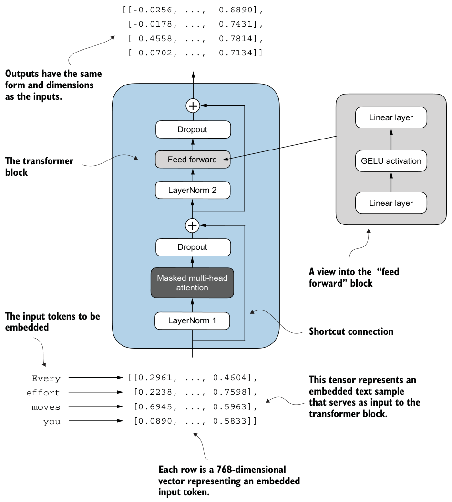

---

### Data Flow in a Pre-LayerNorm Transformer Block

GPT-2 adopts a **Pre-LayerNorm** structure where layer normalization is applied *before* the multi-head attention and feed-forward sub-modules:

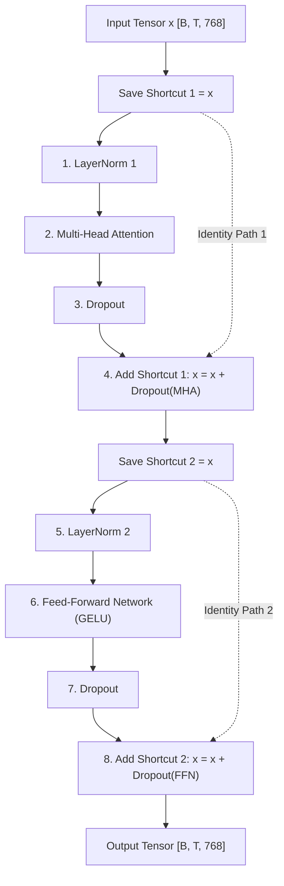

---

### Pre-LayerNorm vs. Post-LayerNorm

```
Post-LayerNorm (Original 2017 Transformer):
x ──► MHA(x) ──► Dropout ──► ( + x ) ──► LayerNorm ──► y
(LayerNorm on the main trunk alters the identity connection, causing gradient impedance)

Pre-LayerNorm (GPT-2 & Modern LLMs):
x ──► LayerNorm(x) ──► MHA ──► Dropout ──► ( + x ) ──► y
(Main trunk remains an unattenuated identity gradient highway)
```

| Aspect | Post-LayerNorm (Original 2017) | Pre-LayerNorm (GPT-2 & Modern LLMs) |
|---|---|---|
| **LayerNorm Position** | Placed **after** residual addition: $\text{LN}(\mathbf{x} + \text{MHA}(\mathbf{x}))$ | Placed **before** sub-modules: $\mathbf{x} + \text{MHA}(\text{LN}(\mathbf{x}))$ |
| **Gradient Flow** | Gradients passing through the main trunk are continuously rescaled by LayerNorm denominators | **Pure identity gradient highway** along the residual trunk |
| **Training Stability** | Unstable in deep networks; strictly requires careful learning rate warm-up | **Highly stable**; converges reliably across 12–100+ stacked layers |

---

### Shape Invariance

* **Input Shape:** `[B, T, emb_dim]` (e.g., `[2, 4, 768]`)
* **Output Shape:** `[B, T, emb_dim]` (e.g., `[2, 4, 768]`)

While the physical dimensions remain unchanged, every token's vector representation is:
1. **Contextualized** via inter-token attention.
2. **Deepened** via non-linear feed-forward transformations.

---

### C API

[`include/transformer.h`](../include/transformer.h):

```c
typedef struct {
    LayerNorm norm1;
    MultiHeadAttention att;
    LayerNorm norm2;
    FeedForward ff;
    double drop_rate; /* drop_shortcut */
} TransformerBlock;

size_t transformer_block_num_params(size_t emb_dim, bool qkv_bias);
void transformer_block_bind(TransformerBlock *tb, float *params, size_t emb_dim, size_t n_heads,
                            bool qkv_bias, double dropout);
void transformer_block_init(const TransformerBlock *tb, Rng *rng);
size_t transformer_block_scratch_size(const TransformerBlock *tb, size_t B, size_t T);
void transformer_block_forward(float *out, const float *x, size_t B, size_t T,
                               const TransformerBlock *tb, float *scratch, Rng *rng);
```

- `transformer_block_bind` lays a block over consecutive floats in the order of PyTorch's `block.parameters()`.
- Unlike the Chapter 3 layers, the scratch size grows with `B`: each dropout covers the whole batch before the next one starts, so the random draws follow PyTorch's order.
- A `NULL` rng means evaluation mode.

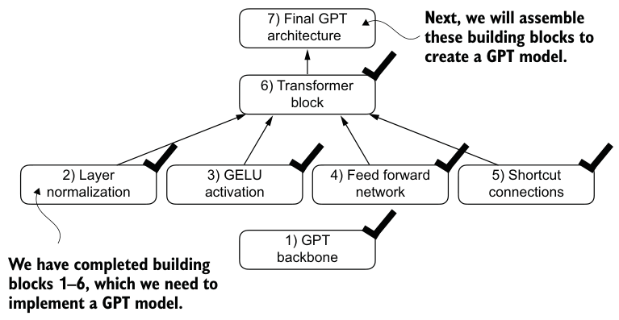

---

## 4.6 Coding the GPT Model

**Why:** With all constituent modules implemented (`Embedding`, `TransformerBlock`, `LayerNorm`, `Linear`), we assemble the complete **GPT-2 architecture** capable of mapping tokenized sequence IDs to vocabulary-sized output logits.

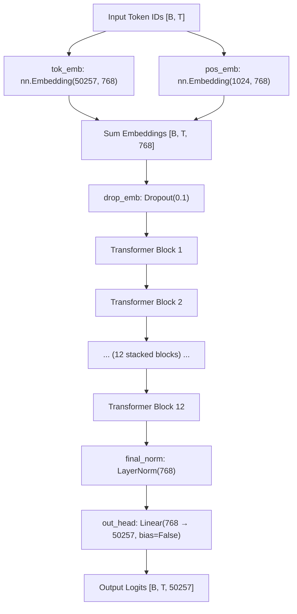

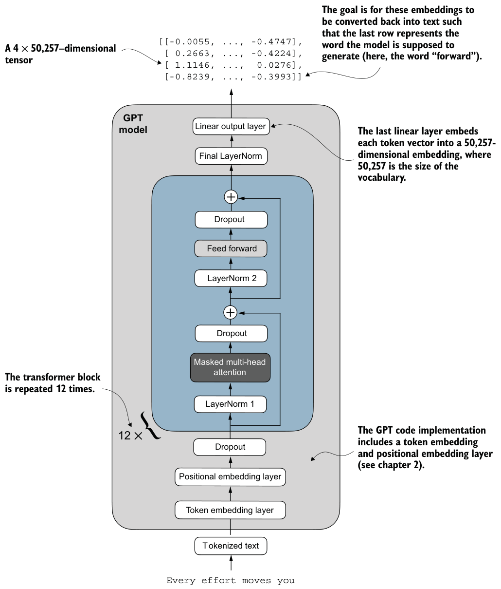

---

### Parameter Count Breakdown (GPT-2 Small)

The total parameter count of the standard standalone GPT-2 architecture is **163,009,536** (~163 million):

| Component | Dimensions / Shape | Parameter Count |
|---|---|---|
| **Token Embedding** (`tok_emb`) | $50,257 \times 768$ | **38,597,376** |
| **Positional Embedding** (`pos_emb`) | $1,024 \times 768$ | **786,432** |
| **12 Transformer Blocks** | $12 \times 7,085,568$ | **85,026,816** |
| - *MHA ($W_q, W_k, W_v, W_{\text{out}}$ + out_proj bias)* | $4 \times (768 \times 768) + 768$ | *2,360,064 / block* |
| - *FFN (2 Linear layers)* | $(768 \times 3072) + 3072 + (3072 \times 768) + 768$ | *4,722,432 / block* |
| - *2 LayerNorms* | $2 \times (768 \times 2)$ | *3,072 / block* |
| **Final LayerNorm** (`final_norm`) | $768 \times 2$ | **1,536** |
| **Linear Output Head** (`out_head`) | $768 \times 50,257$ | **38,597,376** |
| **TOTAL** | | **163,009,536** |

---

### Weight Tying: Why is it called GPT-2 124M?

In the original OpenAI GPT-2 architecture, a technique called **Weight Tying** was applied:
- The weights of `tok_emb` and `out_head` are shared directly: $\mathbf{W}_{\text{out}} = \mathbf{W}_{\text{tok\_emb}}^T$.
- Subtracting the shared output layer parameter count:
  $$163,009,536 - 38,597,376 = \mathbf{124,412,160} \approx \mathbf{124 \text{ Million Parameters}}$$

> In modern LLM training and throughout this implementation, keeping the embedding and output projection layers separate yields slightly superior empirical performance. Weight tying will be revisited in Chapter 6 when loading official OpenAI pretrained weights.

---

### Memory Requirements

Assuming single-precision 32-bit floating point (`float32`, 4 bytes per parameter):

$$\text{Memory} = 163,009,536 \times 4 \text{ bytes} = 652,038,144 \text{ bytes} \approx \mathbf{621.83 \text{ MB}}$$

---

### GPT-2 Model Family Scaling

The exact same `GPTModel` architecture scales to larger configurations simply by varying the configuration hyper-parameters:

| Model Variant | Parameters | Layers ($N$) | Hidden Dim ($d_{\text{emb}}$) | Heads ($h$) | Head Dim |
|---|---|---|---|---|---|
| **GPT-2 Small** | **124M** | 12 | 768 | 12 | 64 |
| **GPT-2 Medium** | **345M** | 24 | 1024 | 16 | 64 |
| **GPT-2 Large** | **762M** | 36 | 1280 | 20 | 64 |
| **GPT-2 XL** | **1,542M (1.5B)** | 48 | 1600 | 25 | 64 |

---

### C API

[`include/gpt.h`](../include/gpt.h):

```c
typedef struct {
    GPTConfig cfg;
    float *tok_emb;       /* [vocab_size x emb_dim], start of the parameter buffer */
    float *pos_emb;       /* [context_length x emb_dim] */
    float *blocks;        /* n_layers blocks, see gpt_block */
    LayerNorm final_norm; /* [emb_dim] scale and shift */
    float *out_head;      /* [vocab_size x emb_dim] */
} GPTModel;

size_t gpt_num_params(const GPTConfig *cfg);
void gpt_bind(GPTModel *model, const GPTConfig *cfg, float *params);
TransformerBlock gpt_block(const GPTModel *model, size_t layer);
void gpt_init(const GPTModel *model, Rng *rng);
size_t gpt_scratch_size(const GPTModel *model, size_t B, size_t T);
void gpt_forward(float *logits, const int *ids, size_t B, size_t T, const GPTModel *model,
                 float *scratch, Rng *rng);
```

- **One buffer.** All parameters live in one caller-owned buffer of `gpt_num_params(&cfg)` floats, in the order of PyTorch's `model.parameters()`; `gpt_bind` lays the model over it.
- **Initialization order.** `gpt_init` draws in PyTorch's order, so seed 123 reproduces the book's logits.

---

## 4.7 Generating Text

**Why:** With the full model architecture assembled, the final step is writing the **autoregressive text generation loop** to iteratively convert model output logits into sequences of new tokens.

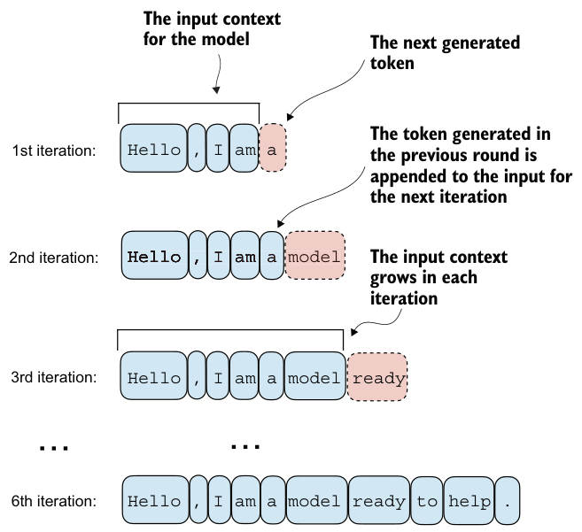

---

### Autoregressive Next-Token Generation Cycle

A generative LLM operates **autoregressively**: it produces text one token at a time, continually appending newly predicted tokens to its input context for subsequent iterations.

```
Initial Prompt: "Hello, I am"
  ├── Iteration 1: Predict next token ──► "a"     ──► Updated Context: "Hello, I am a"
  ├── Iteration 2: Predict next token ──► "model" ──► Updated Context: "Hello, I am a model"
  ├── Iteration 3: Predict next token ──► "ready" ──► Updated Context: "Hello, I am a model ready"
  └── ... repeats until reaching max_new_tokens.
```

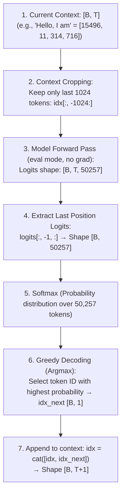

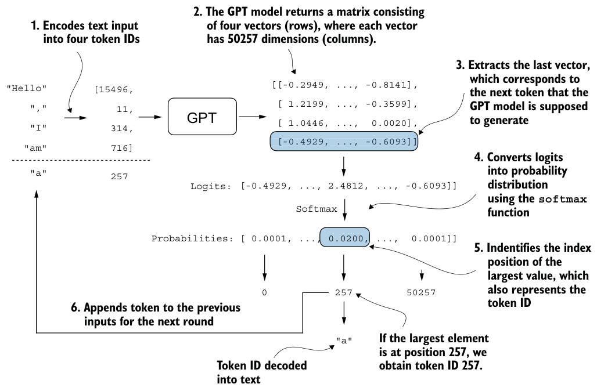

---

### Step-by-Step Generation Mechanics

1. **Context Cropping:** If the accumulated sequence length $T$ exceeds the supported `context_length` (1024), slice `idx[:, -context_length:]` so positional embeddings do not overflow.
2. **Evaluation Mode:** Disable stochastic operations (such as dropout) via `model.eval()` and run without computing gradients (`torch.no_grad()`).
3. **Last Position Focus:** The model predicts logits for *every* position in the sequence, but only the **last position** (`logits[:, -1, :]`) corresponds to the next unseen token.
4. **Greedy Decoding (Argmax):** Select the token ID with the highest logit/probability score:
   $$\text{token}_{\text{next}} = \arg\max_{v} (\text{logits}_{v})$$
   *(Since softmax is strictly monotonic, $\arg\max(\text{softmax}(\mathbf{z})) \equiv \arg\max(\mathbf{z})$).*
5. **Concatenation & Repeat:** Append `token_next` to the sequence and repeat for `max_new_tokens`.

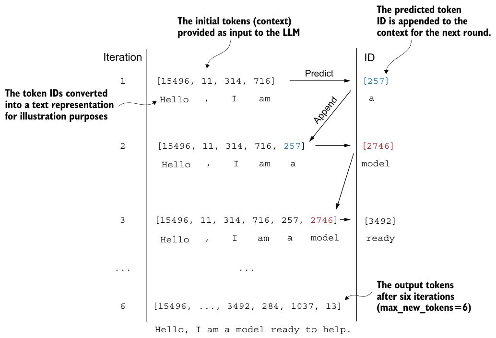

---

### Why Untrained Models Output Gibberish

When testing generation with an untrained `GPTModel` on the prompt `"Hello, I am"`:

```text
Prompt:  "Hello, I am"
Output:  "Hello, I am Featureiman Byeswickattribute argue"
```

* **Cause:** The model currently holds only **randomly initialized weights**. It has structural capability to generate text, but possesses zero linguistic knowledge or statistical word association.
* **Solution:** **Chapter 5 (Pretraining)** will train these weights on large unlabeled text corpora using next-token cross-entropy loss to produce coherent, human-like language.

---

### C API

[`include/gpt.h`](../include/gpt.h):

```c
size_t generate_scratch_size(const GPTModel *model, size_t context_size);
size_t generate_text_simple(int *ids, size_t n, size_t max_new_tokens, size_t context_size,
                            const GPTModel *model, float *scratch);
```

`ids` holds the `n` prompt tokens and has room for `max_new_tokens` more; the return value is the new length. Generation runs one sequence in evaluation mode. Only the last position goes through `final_norm` and `out_head`, so no `[T x 50257]` logits buffer is needed per step.

---

## Chapter 4 Summary

- **Layer Normalization** stabilizes forward activations and backward gradient flow by continually normalizing feature distributions to $\mu=0, \sigma^2=1$.
- **GELU Activation** provides smooth, continuous non-linearity and preserves non-zero gradient flow for negative inputs, preventing dead neurons.
- **Feed-Forward Networks (FFN)** operate position-wise to expand token representations into higher-dimensional space ($4 \times d_{\text{emb}}$) before projecting back, deepening the model's non-linear expressive capacity.
- **Shortcut / Residual Connections** introduce an explicit identity term ($\mathbf{I}$) into the backpropagation chain rule, establishing an unimpeded gradient superhighway that prevents vanishing gradients.
- **Transformer Blocks** integrate Pre-LayerNorm, Masked Multi-Head Attention, Dropout, and Feed-Forward Networks while maintaining shape invariance (`[B, T, emb_dim]`).
- **GPT-2 (124M)** stacks 12 transformer blocks atop token and positional embeddings, mapping to 50,257 output logits.
- **Autoregressive Generation** iteratively predicts the next token ID using greedy decoding (`argmax`) or sampling, continually appending to the input context.
- An **untrained GPT model** outputs random gibberish, motivating the pretraining methodology covered in **Chapter 5**.

---
