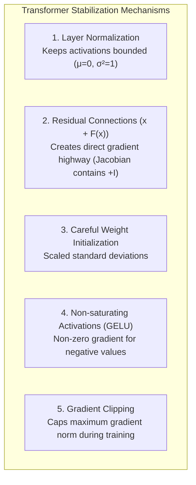

# Gradients, Backpropagation, and Vanishing / Exploding Gradients

> **Topic:** Foundational Optimization & Deep Learning Theory  
> **Relevant to:** Chapter 3 (Attention), Chapter 4 (LayerNorm & Residual Connections), Chapter 5 (Pretraining)

---

## 1. What is a Gradient?

At its core, training a neural network is an **optimization problem**: finding a set of weights $\mathbf{W}$ that minimizes a scalar loss function $\mathcal{L}(\mathbf{W})$ (prediction error).

```
         Loss ℒ(W)
            ▲
            │     * (Current weights W)
            │      \   ← Gradient ∇ℒ points in direction of steepest ASCENT
            │       \
            │        \___ (Valley: Global/Local Minimum - Lowest Error)
            └──────────────────────► Weights W
```

### The Intuition: Navigating in Dense Fog
Imagine being blindfolded on a foggy mountainside with the goal of reaching the lowest point in the valley:
* You feel the terrain beneath your feet to determine the steepest upward slope.
* To go down, you simply take a step in the **exact opposite direction**.

### The Math: Vector of Partial Derivatives
The **Gradient** $\nabla_{\mathbf{W}} \mathcal{L}$ is the vector of partial derivatives with respect to every trainable parameter:

$$\nabla_{\mathbf{W}} \mathcal{L} = \begin{bmatrix} \frac{\partial \mathcal{L}}{\partial W_1} \\ \frac{\partial \mathcal{L}}{\partial W_2} \\ \vdots \\ \frac{\partial \mathcal{L}}{\partial W_k} \end{bmatrix}$$

Each component $\frac{\partial \mathcal{L}}{\partial W_i}$ answers a single question:
> *"If I nudge weight $W_i$ up by a tiny amount $\epsilon$, how much will the total loss $\mathcal{L}$ increase or decrease?"*

### Gradient Descent Update Rule
The weights are iteratively updated in the negative gradient direction:

$$\mathbf{W}_{\text{new}} = \mathbf{W}_{\text{old}} - \eta \cdot \nabla_{\mathbf{W}} \mathcal{L}$$

where $\eta > 0$ is the **learning rate** (step size).

---

## 2. Backpropagation and the Chain Rule in Deep Networks

In modern deep architectures like GPT-2 (which stacks 12 transformer blocks), data passes sequentially through many layers during the forward pass:

$$\mathbf{x}_0 \xrightarrow{\text{Layer 1}} \mathbf{x}_1 \xrightarrow{\text{Layer 2}} \mathbf{x}_2 \dots \xrightarrow{\text{Layer } N} \mathbf{x}_N \xrightarrow{\text{Loss}} \mathcal{L}$$

To compute the gradient for early layers (e.g. $\mathbf{W}_1$), backpropagation applies the **multivariate chain rule**:

$$\frac{\partial \mathcal{L}}{\partial \mathbf{W}_1} = \frac{\partial \mathcal{L}}{\partial \mathbf{x}_N} \cdot \mathbf{J}_{N} \cdot \mathbf{J}_{N-1} \cdots \mathbf{J}_{2} \cdot \frac{\partial \mathbf{x}_1}{\partial \mathbf{W}_1}$$

where $\mathbf{J}_l = \frac{\partial \mathbf{x}_l}{\partial \mathbf{x}_{l-1}}$ is the **Jacobian matrix** (the derivative of layer $l$'s output with respect to its input).

```
Loss ──► Layer N ──► Layer N-1 ──► ... ──► Layer 2 ──► Layer 1
          (x J_N)     (x J_{N-1})           (x J_2)
```

The critical term is the **repeated product of Jacobians**:

$$\prod_{l=2}^{N} \mathbf{J}_l$$

---

## 3. The Pathologies of Deep Networks

Because backpropagation involves multiplying $N$ matrices together, the magnitude of the signal is extremely sensitive to the values inside those Jacobians:

### 🥀 1. Vanishing Gradients (Triệt tiêu Gradient)

If the spectral norm (eigenvalues) of intermediate Jacobians is systematically less than 1 ($\|\mathbf{J}_l\| < 1$):

$$\lim_{N \to \infty} \prod_{l=2}^{N} \mathbf{J}_l \approx 0$$

* **Example:** $0.5^{12} \approx 0.00024$, while $0.5^{50} \approx 8.8 \times 10^{-16}$.
* **Symptoms:**
  - Gradient magnitudes for layers near the input decay to effectively zero ($\approx 10^{-7}$ or less).
  - Early layers receive no update signal ($\Delta \mathbf{W} \approx 0$) and their weights remain at their initial random states.
  - The network fails to learn low-level and syntactic representations.

### 💥 2. Exploding Gradients (Bùng nổ Gradient)

If the spectral norm of intermediate Jacobians is systematically greater than 1 ($\|\mathbf{J}_l\| > 1$):

$$\lim_{N \to \infty} \left\| \prod_{l=2}^{N} \mathbf{J}_l \right\| \to \infty$$

* **Example:** $1.5^{12} \approx 130$, while $1.5^{50} \approx 6.3 \times 10^8$.
* **Symptoms:**
  - Gradient values grow exponentially as they travel backward.
  - Parameter updates $\eta \nabla_{\mathbf{W}} \mathcal{L}$ take massive, uncontrolled leaps across the loss landscape.
  - Floating-point overflow results in `NaN` (Not a Number) or `Inf` loss, destroying model weights entirely.

---

## 4. How Modern Transformers Cure Both Pathologies

Modern LLM architectures (like GPT) combine several structural innovations to guarantee well-behaved gradient flow:



| Mechanism | Section | How it stabilizes gradients |
|---|---|---|
| **Layer Normalization** | [4.2](../ch04-implementing-gpt-model.md#42-normalizing-activations-with-layer-normalization) | Rescales inputs to $\mu=0, \sigma^2=1$, preventing activations and gradients from drifting arbitrarily. |
| **Residual Connections** | [4.4](../ch04-implementing-gpt-model.md#44-adding-shortcut-connections) | Replaces $\mathbf{x}_{l} = F(\mathbf{x}_{l-1})$ with $\mathbf{x}_{l} = \mathbf{x}_{l-1} + F(\mathbf{x}_{l-1})$. The gradient $\frac{\partial \mathbf{x}_l}{\partial \mathbf{x}_{l-1}} = \mathbf{I} + \frac{\partial F}{\partial \mathbf{x}_{l-1}}$ ensures an uninterrupted path of identity matrices $\mathbf{I}$ straight to Layer 1. |
| **GELU Activations** | [4.3](../ch04-implementing-gpt-model.md#43-implementing-a-feed-forward-network-with-gelu-activations) | Avoids the dead-neuron problem of ReLU by maintaining a small, smooth non-zero gradient for negative inputs. |
| **Gradient Clipping** | Ch 5 | Hard ceiling on $\|\mathbf{g}\|_2$: if $\|\mathbf{g}\| > \text{threshold}$, scale $\mathbf{g} \leftarrow \frac{\text{threshold}}{\|\mathbf{g}\|} \mathbf{g}$. |
